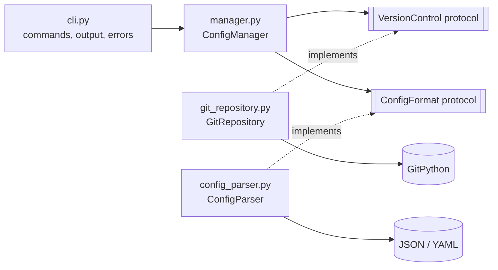

# configctl: Git-Powered Configuration Management CLI

`configctl` stores application configuration files (JSON or YAML) in a Git
repository and manages them with a **draft → publish** workflow:

- every change is a **commit**,
- every draft lives on its own **branch** (`draft/<name>`),
- publishing a draft is a **merge into `main`**,
- any earlier version can be **rolled back** without rewriting history,
- every action is written to a **structured (JSON) audit log**.

Built with Python 3.11+, [GitPython](https://gitpython.readthedocs.io/) and
[click](https://click.palletsprojects.com/).

---

## The key idea: two repositories

| | Source repository (this project) | Configuration repository |
|---|---|---|
| Contains | The `configctl` code, tests, docs | Your config files, e.g. `app.json` |
| Commits made by | Developers | **configctl itself**, through GitPython |
| Where | Here, on GitHub | Anywhere *outside* this project |

`configctl` refuses to create or clone a configuration repository **inside**
another Git repository, so the two can never become nested by accident.

---

## Requirements

- Python **3.11** or newer
- Git **2.28** or newer (for `git init --initial-branch`)
- Windows, macOS or Linux

## Installation

```powershell
git clone https://github.com/Aline-CROIRE/git-config-cli.git
cd git-config-cli
python -m venv .venv
.\.venv\Scripts\Activate.ps1          # macOS/Linux: source .venv/bin/activate
python -m pip install -r requirements-dev.txt
python -m pip install -e .
configctl --version
```

`requirements.txt` lists what the tool needs to run (GitPython, click, PyYAML).
`requirements-dev.txt` adds the testing and code-quality tools.

---

## Quick start: the full lifecycle

The examples use PowerShell. On macOS/Linux, use `/` in paths and
`export CONFIGCTL_REPO=...` instead of `$env:CONFIGCTL_REPO = ...`.

```powershell
# 1. Create a configuration repository next to this project
configctl --repo ..\app-configs init

# Optional: avoid typing --repo for every command
$env:CONFIGCTL_REPO = "..\app-configs"

# 2. Create a draft and change values on it
configctl draft timeout
configctl set timeout app.json timeout 30
configctl set timeout app.json database.host localhost

# 3. Review the draft (main is not changed yet)
configctl show app.json --draft timeout

# 4. Publish: merge the draft into main
configctl publish timeout
configctl show app.json

# 5. See the history and roll back if needed
configctl history app.json
configctl rollback app.json <commit-sha>
```

---

## Global options

| Option | Environment variable | Meaning |
|---|---|---|
| `--repo PATH` | `CONFIGCTL_REPO` | Folder of the configuration repository (default: `.`) |
| `--log-file PATH` | `CONFIGCTL_LOG_FILE` | Audit log file (default: `~/.configctl/audit.log`) |
| `-v`, `--verbose` | | Also print log messages in the terminal |
| `--version` | | Show the version and exit |
| `--help` | | Show help; works for every command, e.g. `configctl set --help` |

**Exit codes:** `0` success · `1` error (clean `Error: ...` message) ·
`2` wrong command usage.

---

## Command reference

### Repository setup

#### `init`: create a configuration repository

```powershell
configctl --repo ..\app-configs init
```
```text
Initialized configuration repository at C:\...\app-configs
```

Creates the repository on branch `main` with a first commit containing a
`.gitignore` for editor and backup files. Fails if a repository already exists
there, or if the folder is inside another Git repository.

#### `remote URL`: connect to a shared server copy

```powershell
configctl --repo ..\app-configs remote https://github.com/me/app-configs.git
```
```text
Remote 'origin' set to https://github.com/me/app-configs.git
```

Adds the remote `origin`, or changes its address if it already exists.

#### `push`: send published configurations to the remote

```powershell
configctl --repo ..\app-configs push
```
```text
Pushed main to origin
```

Only `main` (published configuration) is pushed. Fails with a clear message if
no remote is configured or the push is rejected.

#### `clone URL DESTINATION`: get a full copy, as a teammate would

```powershell
configctl clone https://github.com/me/app-configs.git ..\my-copy
```
```text
Cloned https://github.com/me/app-configs.git into C:\...\my-copy
```

#### `inspect URL FILE`: read a remote config without keeping a copy

```powershell
configctl inspect https://github.com/me/app-configs.git app.json
```

Clones into a **temporary folder**, prints the file from `main` as JSON, then
deletes the temporary folder automatically (even if something fails).

### Configuration workflow

#### `draft NAME`: start a draft

```powershell
configctl draft timeout
```
```text
Created draft 'timeout' on branch draft/timeout
```

Creates branch `draft/timeout` from `main`. Draft names may contain letters,
numbers, `.`, `_` and `-`, and must start with a letter or number.

#### `set DRAFT FILE KEY VALUE`: change one value on a draft

```powershell
configctl set timeout app.json timeout 30
configctl set timeout app.yaml database.port 5432
```
```text
Set timeout in app.json on draft 'timeout' (commit 3ef635f)
```

- The file is created if it does not exist yet.
- Dots in `KEY` reach into nested sections (`database.port`).
- The format comes from the extension: `.json`, `.yaml` or `.yml`.
- `VALUE` is read as JSON when possible, otherwise kept as text:

| You type | Stored as |
|---|---|
| `30` | number `30` |
| `true` | boolean `true` |
| `[1, 2]` | list |
| `localhost` | text `"localhost"` |

Each `set` is one commit on the draft branch. `main` is not touched.

#### `show FILE [--draft NAME]`: print a configuration

```powershell
configctl show app.json
configctl show app.json --draft timeout
```
```json
{
  "database": {
    "host": "localhost"
  },
  "timeout": 30
}
```

#### `publish DRAFT`: merge a draft into main

```powershell
configctl publish timeout
```
```text
Published draft 'timeout' into main (commit c6f9683)
```

Before merging, every JSON/YAML file the draft changed is **validated**. A
draft with invalid content (for example leftover conflict markers) is refused
and `main` is left unchanged.

#### `history FILE`: list the published changes to a file

```powershell
configctl history app.json
```
```text
3ef635f  2026-10-14 16:32  Aline-CROIRE  Set database.host in app.json
ed35f81  2026-10-14 16:32  Aline-CROIRE  Set timeout in app.json
```

#### `rollback FILE REVISION`: restore an earlier version

```powershell
configctl rollback app.json ed35f81
```
```text
Rolled back app.json to ed35f81 (new commit 0840a39)
```

The old content is committed again as a **new** commit on `main`. History is
never rewritten, so the audit trail stays complete.

---

## How the Git workflow works

### Drafts, publishing and history

```text
main      A ───────────────── M   ← "Publish draft/timeout" (merge commit)
           \                 /
draft/     B ── C ──────────┘     ← one commit per `set`
timeout
```

- **Drafts are branches.** Changes stay isolated until published.
- **The working folder always returns to `main`.** Each draft operation checks
  the draft out inside a context manager and switches back afterwards. If an
  operation fails and leaves unsaved changes, the tool stays on the draft
  instead of throwing work away.
- **Publishing uses `git merge --no-ff`**, so every publish creates a merge
  commit. The history records *when* each draft was published.
- **Keys are written sorted**, with Unix line endings, so the same data always
  produces the same text. Diffs show only real changes.

### Merge conflicts

Two drafts that change the same value conflict when the second is published:

```text
Error: Cannot publish draft 'slow': it conflicts with main in:
  - app.json

Nothing was changed on main. To resolve the conflict:
  1. cd ..\app-configs
  2. git switch draft/slow
  3. git merge main
  4. Edit each conflicted file: keep the values you want and delete
     the <<<<<<<, ======= and >>>>>>> marker lines
  5. git add <file>, then git commit
  6. configctl --repo ..\app-configs publish slow
```

What the tool does:

1. **Detects** the conflict and asks Git which files are unmerged.
2. **Aborts** the merge (`git merge --abort`), so `main` is exactly as before.
3. **Reports** it as a `MergeConflictError` with the branch and the files.
4. **Guides** the user through the standard fix: merge `main` into the draft,
   resolve there, then publish again.

Tip: open the conflicted file with `code --wait app.json`, so the terminal
waits until you close the file. If conflict markers are committed by mistake,
`publish` refuses the draft because the file is no longer valid JSON/YAML.

### Sharing with a team

```powershell
# A local "server" for trying this out (works the same with GitHub)
git init --bare --initial-branch=main ..\config-server.git

configctl --repo ..\app-configs remote ..\config-server.git
configctl --repo ..\app-configs push
configctl inspect ..\config-server.git app.json
configctl clone ..\config-server.git ..\teammate-configs
```

---

## Audit logging

Every action that changes something (`init`, `clone`, `remote`, `push`,
`draft`, `set`, `publish`, `rollback`) and every failure is written as one JSON
object per line (JSON Lines) to `~/.configctl/audit.log`:

```json
{"time": "2026-10-15T06:57:56+00:00", "level": "INFO", "logger": "configctl.manager", "message": "Draft published", "action": "draft.publish", "draft": "logs-demo", "commit": "b0a9063..."}
```

Because entries are structured, they can be filtered like a table:

```powershell
Get-Content $HOME\.configctl\audit.log |
    ForEach-Object { $_ | ConvertFrom-Json } |
    Format-Table time, level, action, draft, commit
```

- **Configuration values are never logged.** Only the key that changed is
  recorded, because values are often passwords or API keys.
- The log lives outside the configuration repository, so it never makes the
  repository "dirty".
- Use `-v` to also see log messages in the terminal.

---

## Architecture



| Module | Single responsibility |
|---|---|
| `cli.py` | Parse commands, print results, turn errors into clean messages |
| `manager.py` | Business logic: drafts, set, publish, validation, history, rollback |
| `protocols.py` | Abstractions (`VersionControl`, `ConfigFormat`) the manager depends on |
| `git_repository.py` | **All** Git operations through GitPython; knows nothing about JSON/YAML |
| `config_parser.py` | Read, write and validate JSON/YAML; knows nothing about Git |
| `exceptions.py` | Custom exception hierarchy |
| `logging_config.py` | JSON audit logging setup |

**SOLID in practice**

- **Single responsibility:** Git logic and file parsing live in separate
  classes; the CLI only coordinates.
- **Dependency inversion:** `ConfigManager` depends on the `VersionControl` and
  `ConfigFormat` *protocols*, not on the concrete classes. The real classes are
  chosen in one place in `cli.py` (the composition root), and tests can pass
  mocks instead.

## Error handling

All errors inherit from `ConfigCtlError`, so the CLI catches them in one place
and prints a clean `Error: ...` message (exit code 1). Unexpected bugs still
show a full traceback.

| Exception | Raised when |
|---|---|
| `ConfigNotFound` | A file or revision does not exist |
| `InvalidRepoError` | A path is not a usable repository, or would be nested |
| `InvalidConfigError` | Content is invalid, a key is invalid, or a path escapes the repository |
| `UnsupportedFormatError` | The file extension is not `.json`, `.yaml` or `.yml` |
| `BranchError` | A draft is missing or exists already, or the repository has uncommitted changes |
| `MergeConflictError` | Publishing a draft conflicts with `main` (includes the files) |
| `RemoteError` | No remote is configured, or a push fails |

---

## Testing

```powershell
pytest                                            # run all tests
pytest --cov --cov-report=term-missing            # with coverage
pytest --cov --cov-report=html; start htmlcov\index.html
```

- **106 tests**, **100% line and branch coverage** (see [COVERAGE.md](COVERAGE.md)).
- A **fixture creates a fresh, temporary Git repository for every test**, and
  tests check the real Git state (commits, branches, merge parents, file
  content) with GitPython directly.
- **Real merge conflicts** are created on purpose, including a test that
  follows the printed resolution steps and then publishes successfully.
- **Mocking** simulates failures without real Git operations: a failed push,
  a merge that fails for a non-conflict reason, and a full disk while writing.
- Tests use a fixed Git identity and a temporary audit log, so they never
  depend on, or write to, the developer's own settings.

The suite takes a few minutes because it runs real Git commands.

## Code quality

| Tool | Purpose | Command |
|---|---|---|
| Black | Formatting | `black .` |
| Ruff | Linting, import order, Google-style docstrings | `ruff check .` |
| mypy | Strict type checking | `mypy` |
| pre-commit | Runs all of the above before every commit | `pre-commit install` |

The pre-commit hooks run the tools from the virtual environment, so activate
`.venv` before committing.

---

## Project structure

```text
git-config-cli/
├── src/configctl/
│   ├── __init__.py
│   ├── cli.py
│   ├── config_parser.py
│   ├── exceptions.py
│   ├── git_repository.py
│   ├── logging_config.py
│   ├── manager.py
│   └── protocols.py
├── tests/
│   ├── conftest.py                 # temporary repo, Git identity, audit log fixtures
│   ├── test_cli.py
│   ├── test_config_parser.py
│   ├── test_exceptions.py
│   ├── test_git_repository.py
│   ├── test_logging.py
│   ├── test_manager.py
│   ├── test_merge_conflicts.py
│   ├── test_publish_validation.py
│   └── test_remote.py
├── .gitignore
├── .pre-commit-config.yaml
├── COVERAGE.md
├── pyproject.toml
├── requirements.txt
└── requirements-dev.txt
```

## Known limitations

- Rewriting a YAML file through `set` or `rollback` removes YAML comments
  (PyYAML does not keep them).
- `history` lists the commits that changed a file; the publish merge commits
  themselves are visible with `git log --graph`.
- Only the `origin` remote and the `main` branch are pushed.
